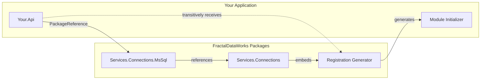

# Package Management

FractalDataWorks uses central package management to control NuGet package versions in one place.

## Directory.Packages.props

From [`samples/ReferenceSolution/Directory.Packages.props`](../../samples/ReferenceSolution/Directory.Packages.props):

```xml
<Project>
  <PropertyGroup>
    <ManagePackageVersionsCentrally>true</ManagePackageVersionsCentrally>
  </PropertyGroup>
  <ItemGroup>
    <!-- FractalDataWorks packages from local feed -->
    <PackageVersion Include="FractalDataWorks.Abstractions" Version="0.30.0-alpha.1182" />
    <PackageVersion Include="FractalDataWorks.Collections" Version="0.30.0-alpha.1182" />
    <PackageVersion Include="FractalDataWorks.Collections.SourceGenerators" Version="0.30.0-alpha.1182">
      <IncludeAssets>runtime; build; native; contentfiles; analyzers</IncludeAssets>
      <PrivateAssets>all</PrivateAssets>
    </PackageVersion>
    <PackageVersion Include="FractalDataWorks.Registration.SourceGenerators" Version="0.30.0-alpha.1182">
      <IncludeAssets>runtime; build; native; contentfiles; analyzers</IncludeAssets>
      <PrivateAssets>all</PrivateAssets>
    </PackageVersion>
    <PackageVersion Include="FractalDataWorks.MessageLogging.Abstractions" Version="0.30.0-alpha.1182" />
    <PackageVersion Include="FractalDataWorks.MessageLogging.SourceGenerators" Version="0.30.0-alpha.1182">
      <IncludeAssets>runtime; build; native; contentfiles; analyzers; buildtransitive</IncludeAssets>
      <PrivateAssets>all</PrivateAssets>
    </PackageVersion>
    <PackageVersion Include="FractalDataWorks.Results" Version="0.30.0-alpha.1182" />
    <!-- Microsoft packages -->
    <PackageVersion Include="Microsoft.Extensions.DependencyInjection" Version="10.0.1" />
    <PackageVersion Include="Microsoft.Extensions.Hosting" Version="10.0.1" />
    <PackageVersion Include="Microsoft.Extensions.Logging.Abstractions" Version="10.0.1" />
    <!-- ... additional packages omitted for brevity -->
  </ItemGroup>
</Project>
```

## Using Packages in Projects

With central package management, project files reference packages without versions.

From [`samples/ReferenceSolution/concepts/01-type-collections/src/Reference.TypeCollections/Reference.TypeCollections.csproj:1-10`](../../samples/ReferenceSolution/concepts/01-type-collections/src/Reference.TypeCollections/Reference.TypeCollections.csproj):

```xml
<Project Sdk="Microsoft.NET.Sdk">
  <PropertyGroup>
    <OutputType>Exe</OutputType>
  </PropertyGroup>

  <ItemGroup>
    <PackageReference Include="FractalDataWorks.Collections" />
    <PackageReference Include="FractalDataWorks.Collections.SourceGenerators" />
  </ItemGroup>
</Project>
```

## Source Generator Configuration

Source generators require special asset configuration to prevent them from being included as runtime dependencies.

From [`samples/ReferenceSolution/Directory.Packages.props`](../../samples/ReferenceSolution/Directory.Packages.props):

```xml
<PackageVersion Include="FractalDataWorks.Collections.SourceGenerators" Version="0.30.0-alpha.1182">
  <IncludeAssets>runtime; build; native; contentfiles; analyzers</IncludeAssets>
  <PrivateAssets>all</PrivateAssets>
</PackageVersion>
```

### TypeCollection Source Generators

Two source generator packages work together for TypeCollections:

| Package | Purpose | When to Use |
|---------|---------|-------------|
| `Collections.SourceGenerators` | Generates collection implementations | Defining `[TypeCollection]` classes |
| `Registration.SourceGenerators` | Generates module initializers | Defining `[TypeOption]`, `[ServiceTypeOption]`, or `[GenerateMapper]` in separate assemblies |

**Projects defining TypeCollections** need the full generator:

```xml
<PackageReference Include="FractalDataWorks.Collections.SourceGenerators">
  <IncludeAssets>runtime; build; native; contentfiles; analyzers</IncludeAssets>
  <PrivateAssets>all</PrivateAssets>
</PackageReference>
```

**Projects defining only TypeOptions** (extending existing collections) need only the Registration generator:

```xml
<PackageReference Include="FractalDataWorks.Registration.SourceGenerators">
  <IncludeAssets>runtime; build; native; contentfiles; analyzers</IncludeAssets>
  <PrivateAssets>all</PrivateAssets>
</PackageReference>
```

**Consumer projects** typically need neither - service packages like `Services.Connections` embed the Registration generator, so it flows transitively to consumers who add custom TypeOptions.

### Transitive Generator Flow

The Registration generator handles **cross-assembly registration** via module initializers for `[TypeOption]`, `[ServiceTypeOption]`, and `[GenerateMapper]` types:



When your app references `Services.Connections.MsSql`:
1. NuGet restores MsSql and its dependencies (including Services.Connections)
2. The Registration generator embedded in Services.Connections flows to your project
3. The generator scans for `[ServiceTypeOption]` types in referenced assemblies
4. It generates a module initializer in YOUR assembly:

```csharp
// Generated in your application
[ModuleInitializer]
internal static void RegisterServiceTypeOptions()
{
    ConnectionTypes.RegisterMember(new MsSqlConnectionType());
}
```

This runs before `Main()`, ensuring all ServiceTypes are registered before `ConnectionTypes.All()` or `ConnectionTypes.ConfigureAll()` is called.

## Package Sources

From [`samples/ReferenceSolution/nuget.config:1-17`](../../samples/ReferenceSolution/nuget.config):

```xml
<?xml version="1.0" encoding="utf-8"?>
<configuration>
  <packageSources>
    <clear />
    <add key="LocalFdw" value="/home/mike/development/local-nuget" />
    <add key="nuget.org" value="https://api.nuget.org/v3/index.json" />
  </packageSources>

  <packageSourceMapping>
    <packageSource key="LocalFdw">
      <package pattern="FractalDataWorks.*" />
    </packageSource>
    <packageSource key="nuget.org">
      <package pattern="*" />
    </packageSource>
  </packageSourceMapping>
</configuration>
```

The `packageSourceMapping` section ensures FractalDataWorks packages come from the local feed, while all other packages use nuget.org.

## Next Steps

- [Naming Conventions](02-04-Naming-Conventions.md) - Project naming patterns
