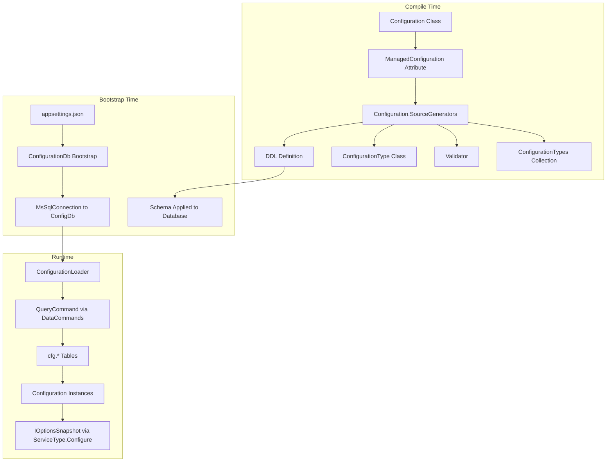
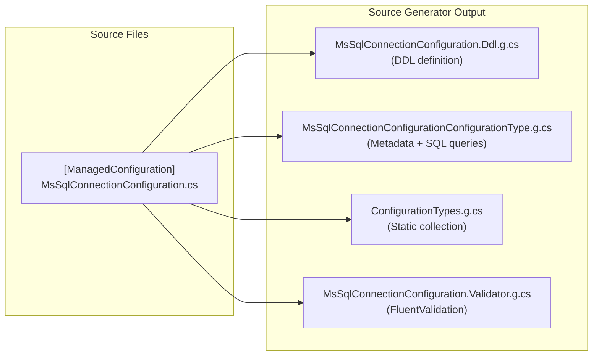
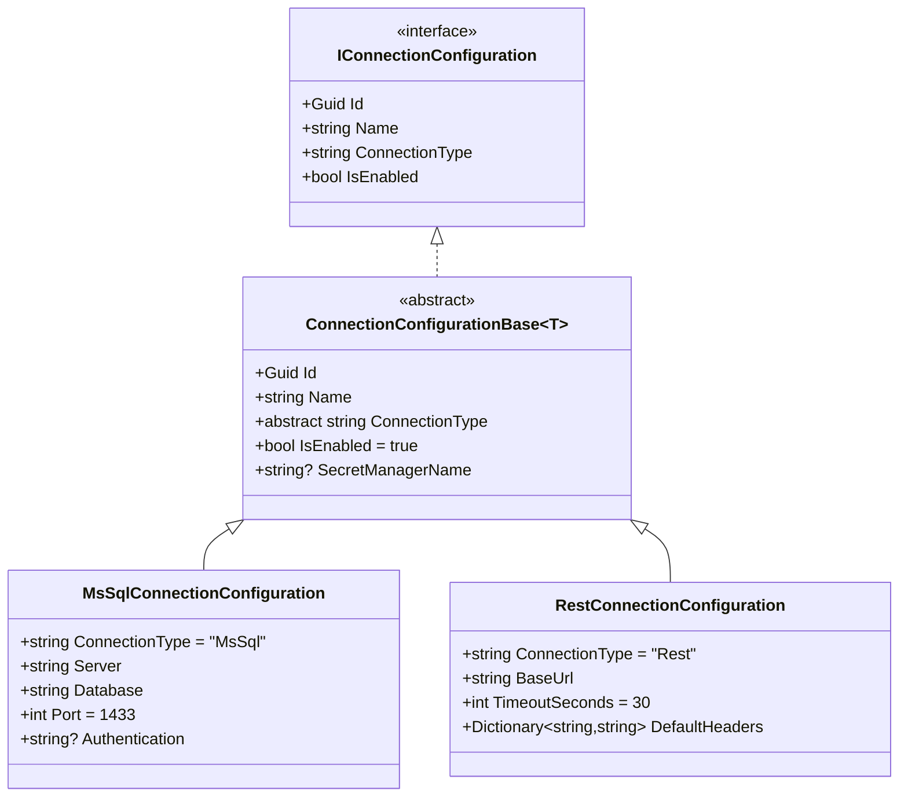
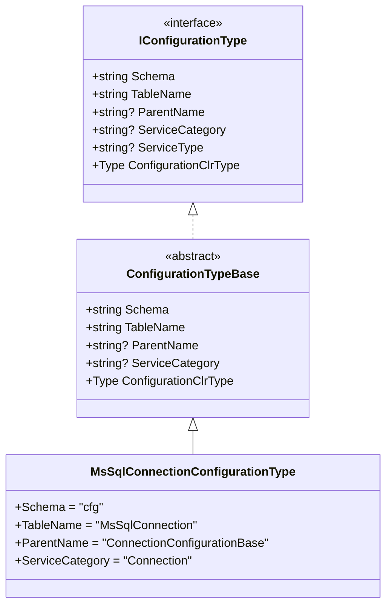
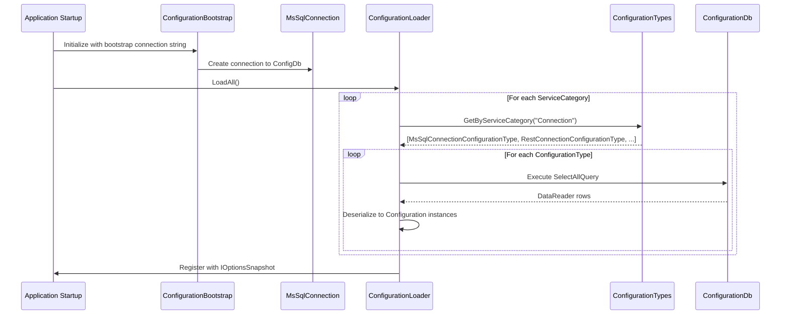

# ManagedConfiguration

ManagedConfiguration is FractalDataWorks' pattern for database-persisted, source-generated configuration. It bridges compile-time type safety with runtime database-driven configuration.

## Overview

The `[ManagedConfiguration]` attribute marks a class for:
- **DDL Generation** - SQL table definitions with parent-child relationships
- **ConfigurationType Generation** - Metadata class with SQL queries
- **Validator Generation** - FluentValidation validators
- **UI Generation** - Form models for configuration editing

## Architecture Flow



## Generation Process



## Parent-Child Configuration

Configuration types often have inheritance hierarchies. The parent holds common properties, children hold type-specific properties.



### Database Schema

Parent-child relationships create separate tables with foreign keys. Additionally, **shared PK extension tables** provide 1:1 relationships where the extension's Id is both the primary key AND a foreign key to the parent:

```mermaid
erDiagram
    Connection {
        uniqueidentifier Id PK
        nvarchar(256) Name UK
        nvarchar(50) ServiceOptionType
        bit IsEnabled
    }

    ConnectionAuthentication {
        uniqueidentifier Id PK_FK
        nvarchar(50) Type
        nvarchar(256) Username
        nvarchar(256) SecretManagerName
        nvarchar(256) SecretKeyName
    }

    MsSqlConnection {
        uniqueidentifier Id PK
        uniqueidentifier ConnectionId FK
        nvarchar(256) Server
        nvarchar(256) Database
        int Port
    }

    RestConnection {
        uniqueidentifier Id PK
        uniqueidentifier ConnectionId FK
        nvarchar(2048) BaseUrl
        int TimeoutSeconds
        nvarchar(max) DefaultHeaders
    }

    Connection ||--o| ConnectionAuthentication : "extends (shared PK)"
    Connection ||--o| MsSqlConnection : "has"
    Connection ||--o| RestConnection : "has"
```

**Table Relationship Patterns:**

| Pattern | FK Column | Use Case |
|---------|-----------|----------|
| **Parent-Child** | `{ParentName}Id` (e.g., `ConnectionId`) | Type-specific properties (MsSqlConnection, RestConnection) |
| **Shared PK Extension** | `Id` (same as parent) | Optional 1:1 extensions (ConnectionAuthentication) |

The `MsSqlConfigurationProvider` automatically loads both patterns:
- **Parent-Child**: Loads parent row first, then flattens child properties
- **Shared PK Extension**: Loads `{ParentTableName}Authentication` tables (if they exist) and prefixes properties (e.g., `Authentication:Type`)

## ConfigurationTypes Collection

ConfigurationTypes follows the TypeCollection pattern for cross-assembly discovery and runtime registration. Each `[ManagedConfiguration]` class generates a `ConfigurationType` that is automatically registered.

### TypeCollection Architecture



### Cross-Assembly Registration

ConfigurationTypes uses module initializers for cross-assembly discovery:

1. **Source Generator** - `ConfigurationSourceGenerator` generates ConfigurationType classes marked with `[ConfigurationTypeOption]`
2. **Module Initializer Generator** - `ConfigurationTypeModuleInitializerGenerator` (in Registration.SourceGenerators) scans referenced assemblies and generates module initializers in entry points
3. **Runtime** - Module initializers register types with `ConfigurationTypes.Register()`

```csharp
// Generated in entry point (e.g., Reference.Api)
[ModuleInitializer]
public static void RegisterConfigurationTypes()
{
    ConfigurationTypes.Register(new MsSqlConnectionConfigurationType());
    ConfigurationTypes.Register(new RestConnectionConfigurationType());
    // ... all discovered types from referenced assemblies
}
```

### Usage

```csharp
// Lookup by name
var mssqlType = ConfigurationTypes.ByName("MsSqlConnection");

// Lookup by service category
var connectionTypes = ConfigurationTypes.All()
    .Where(t => t.ServiceCategory == "Connection");

// Lookup by service type
var mssqlType = ConfigurationTypes.All()
    .FirstOrDefault(t => t.ServiceType == "MsSql");
```

## Generated ConfigurationType

Each `[ManagedConfiguration]` class generates a `ConfigurationType` with:

| Property | Description |
|----------|-------------|
| `Schema` | Database schema (e.g., "cfg") |
| `TableName` | Table name (e.g., "MsSqlConnection") |
| `ParentName` | Parent configuration name for joins |
| `ParentForeignKeyProperty` | FK column name |
| `ServiceCategory` | Grouping (e.g., "Connection", "SecretManager") |
| `ServiceType` | Discriminator (e.g., "MsSql", "EnvironmentVariable") |
| `SelectAllQuery` | Generated SQL to load all rows |
| `SelectByNameQuery` | Generated SQL to load by name |
| `ConfigurationClrType` | The CLR Type for deserialization |

## Runtime Loading Flow



## Usage Example

### 1. Define Configuration Class

```csharp
[ManagedConfiguration(
    Schema = "cfg",
    TableName = "MsSqlConnection",
    Parent = nameof(ConnectionConfigurationBase<MsSqlConnectionConfiguration>),
    ServiceCategory = "Connection",
    ServiceType = "MsSql")]
public partial class MsSqlConnectionConfiguration
    : ConnectionConfigurationBase<MsSqlConnectionConfiguration>
{
    public override string ConnectionType => "MsSql";

    public string Server { get; set; } = "localhost";
    public string Database { get; set; } = string.Empty;
    public int Port { get; set; } = 1433;

    [ConfigurationOption(typeof(AuthenticationMethods))]
    public string? Authentication { get; set; }
}
```

### 2. Generated DDL (Simplified)

```sql
-- Parent table (if not exists)
CREATE TABLE cfg.ConnectionConfigurationBase (
    Id uniqueidentifier NOT NULL PRIMARY KEY,
    Name nvarchar(256) NOT NULL UNIQUE,
    ConnectionType nvarchar(50) NOT NULL,
    IsEnabled bit NOT NULL DEFAULT 1,
    SecretManagerName nvarchar(256) NULL
);

-- Child table
CREATE TABLE cfg.MsSqlConnection (
    Id uniqueidentifier NOT NULL PRIMARY KEY,
    Name nvarchar(256) NOT NULL UNIQUE,
    ConnectionConfigurationId uniqueidentifier NOT NULL,
    Server nvarchar(256) NOT NULL,
    [Database] nvarchar(256) NOT NULL,
    Port int NOT NULL DEFAULT 1433,
    Authentication nvarchar(50) NULL,
    CONSTRAINT FK_MsSqlConnection_ConnectionConfigurationBase
        FOREIGN KEY (ConnectionConfigurationId)
        REFERENCES cfg.ConnectionConfigurationBase(Id)
);
```

### 3. Access at Runtime

```csharp
// Via ConfigurationTypes collection (generated)
var mssqlType = ConfigurationTypes.ByName("MsSqlConnectionConfiguration");
Console.WriteLine($"Table: {mssqlType.Schema}.{mssqlType.TableName}");
Console.WriteLine($"Parent: {mssqlType.ParentName}");

// Via IOptionsSnapshot (standard .NET)
public class MyService
{
    private readonly IOptionsSnapshot<List<MsSqlConnectionConfiguration>> _configs;

    public MyService(IOptionsSnapshot<List<MsSqlConnectionConfiguration>> configs)
    {
        _configs = configs;
    }

    public MsSqlConnectionConfiguration? GetByName(string name)
        => _configs.Value.FirstOrDefault(c => c.Name == name);
}
```

## Bootstrap vs Runtime Configuration

| Aspect | Bootstrap (appsettings.json) | Runtime (ConfigurationDb) |
|--------|------------------------------|---------------------------|
| **Purpose** | Connect to ConfigDb | All service configuration |
| **Storage** | JSON file | Database tables |
| **When Loaded** | Application startup | After ConfigDb connection |
| **Examples** | ConfigDb connection, Serilog | Connections, DataSets, SecretManagers |
| **Reloadable** | Restart required | Hot-reload supported |

## Key Components

| Component | Package | Purpose |
|-----------|---------|---------|
| `[ManagedConfiguration]` | Configuration.SourceGenerators | Attribute to mark config classes |
| `ConfigurationTypes` | Generated in each assembly | Static lookup collection |
| `ConfigurationLoader` | Configuration.MsSql | Loads config from database |
| `FdwConfigurationProvider` | Configuration | IConfiguration provider |
| `ManagedConfigurationProvider<T>` | Configuration | Caching provider for hot-reload |

## Related Documentation

- [Service Domains Overview](06-01-Service-Domains-Overview.md) - How configs integrate with services
- [Creating a Service Domain](06-02-Creating-Service-Domain.md) - Step-by-step with configuration
- [TypeCollections](04-01-Overview.md) - TypeCollections referenced by `[ConfigurationOption]`
- [Configuration.SourceGenerators README](../src/FractalDataWorks.Configuration.SourceGenerators/README.md) - Detailed attribute reference
