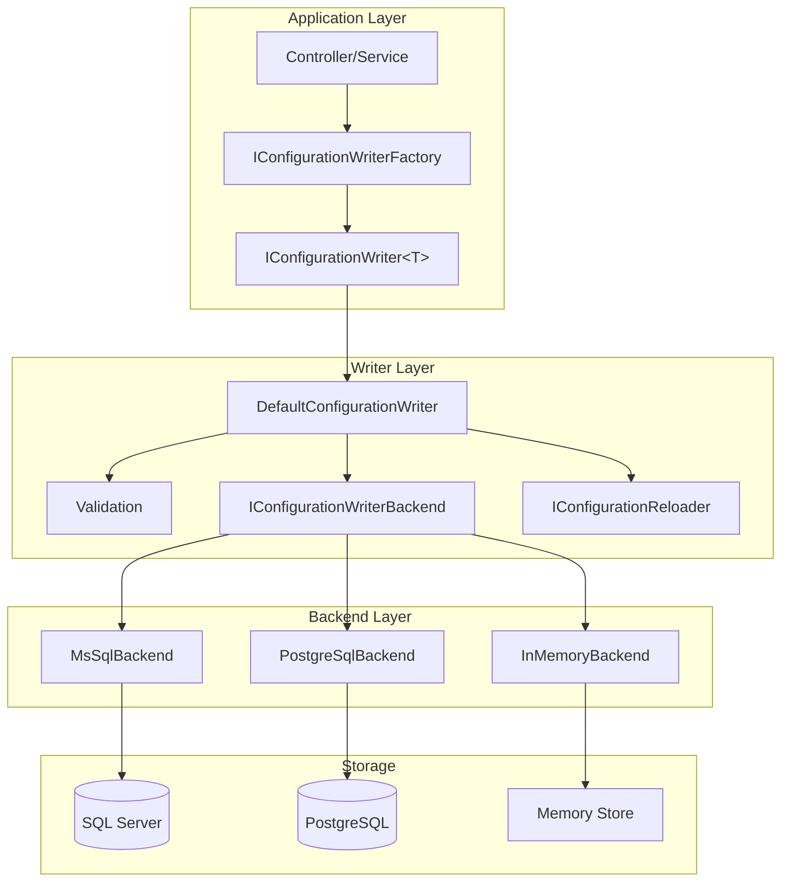
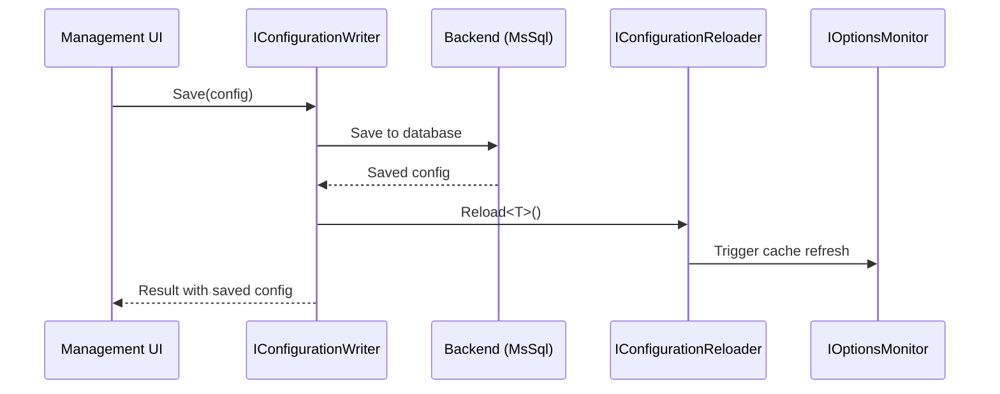

# Configuration Writers

Configuration Writers provide the write side of FractalDataWorks' CQRS-based configuration system. While reads use `IOptionsMonitor<T>`, writes use `IConfigurationWriter<T>` to persist configuration changes to backend stores (MsSql, PostgreSql, InMemory).

## Overview

The Configuration Writers subsystem enables:
- **Type-safe persistence** - Save and delete configurations with compile-time validation
- **Pluggable backends** - Support for multiple database providers
- **Automatic reload** - Trigger local cache refresh after writes
- **Validation integration** - Uses FluentValidation validators before persistence

## Architecture



## Packages

| Package | Purpose |
|---------|---------|
| `FractalDataWorks.Configuration.Writers.Abstractions` | Interfaces: `IConfigurationWriter<T>`, `IConfigurationWriterFactory`, `IConfigurationWriterBackend`, `IConfigurationReloader` |
| `FractalDataWorks.Configuration.Writers` | Core implementation: `DefaultConfigurationWriter`, `DefaultConfigurationWriterFactory`, DI extensions |
| `FractalDataWorks.Configuration.Writers.MsSql` | SQL Server backend |
| `FractalDataWorks.Configuration.Writers.InMemory` | In-memory backend for testing |

## Quick Start

### 1. Register Services

```csharp
// In Program.cs or Startup.cs
var builder = WebApplication.CreateBuilder(args);

// Register configuration writers with options binding
builder.Services.AddConfigurationWriters(builder.Configuration);

// Register backend(s)
builder.Services.AddConfigurationWriterBackend<MsSqlConfigurationWriterBackend>();

var app = builder.Build();

// Initialize after Build() - validates registrations
app.Services.InitializeConfigurationWriters();
```

### 2. Configure Options

```json
// appsettings.json
{
  "ConfigurationWriter": {
    "ConnectionName": "ConfigurationDb",
    "DefaultBackend": "MsSql",
    "ReloadAfterWrite": true,
    "ValidateBeforeWrite": true
  }
}
```

### 3. Use the Writer

```csharp
public class ConnectionService
{
    private readonly IConfigurationWriterFactory _writerFactory;

    public ConnectionService(IConfigurationWriterFactory writerFactory)
    {
        _writerFactory = writerFactory;
    }

    public async Task<IGenericResult<MsSqlConnectionConfiguration>> SaveConnection(
        MsSqlConnectionConfiguration config,
        CancellationToken ct)
    {
        // Create a writer for the configuration type
        var writerResult = _writerFactory.Create<MsSqlConnectionConfiguration>();
        if (writerResult.IsFailure)
            return GenericResult<MsSqlConnectionConfiguration>.Failure(writerResult);

        var writer = writerResult.Value!;

        // Save the configuration (creates or updates)
        return await writer.Save(config, ct);
    }

    public async Task<IGenericResult> DeleteConnection(Guid id, CancellationToken ct)
    {
        var writerResult = _writerFactory.Create<MsSqlConnectionConfiguration>();
        if (writerResult.IsFailure)
            return GenericResult.Failure(writerResult);

        return await writerResult.Value!.Delete(id, ct);
    }
}
```

## Core Interfaces

### IConfigurationWriter&lt;T&gt;

The primary interface for writing configurations:

```csharp
public interface IConfigurationWriter<TConfiguration>
    where TConfiguration : class, IGenericConfiguration
{
    /// <summary>
    /// Saves a configuration (upsert semantics).
    /// If Id is Guid.Empty, a new Id is generated.
    /// </summary>
    Task<IGenericResult<TConfiguration>> Save(
        TConfiguration configuration,
        CancellationToken ct = default);

    /// <summary>
    /// Deletes a configuration by ID (idempotent).
    /// </summary>
    Task<IGenericResult> Delete(Guid id, CancellationToken ct = default);

    /// <summary>
    /// Deletes a configuration by name (idempotent).
    /// </summary>
    Task<IGenericResult> Delete(string name, CancellationToken ct = default);
}
```

### IConfigurationWriterFactory

Creates writers for specific configuration types:

```csharp
public interface IConfigurationWriterFactory
{
    /// <summary>
    /// Creates a writer by inferring the configuration type from generics.
    /// </summary>
    IGenericResult<IConfigurationWriter<TConfiguration>> Create<TConfiguration>()
        where TConfiguration : class, IGenericConfiguration;

    /// <summary>
    /// Creates a writer by configuration type name.
    /// </summary>
    IGenericResult<IConfigurationWriter<TConfiguration>> Create<TConfiguration>(
        string configurationTypeName)
        where TConfiguration : class, IGenericConfiguration;
}
```

### IConfigurationWriterBackend

Low-level interface for database-specific persistence (used internally):

```csharp
public interface IConfigurationWriterBackend
{
    /// <summary>
    /// Database provider this backend supports (e.g., "MsSql", "PostgreSql", "InMemory").
    /// </summary>
    string DatabaseProvider { get; }

    Task<IGenericResult<TConfiguration>> Save<TConfiguration>(
        TConfiguration configuration,
        IConfigurationType configurationType,
        CancellationToken ct = default)
        where TConfiguration : class, IGenericConfiguration;

    Task<IGenericResult> Delete(
        Guid id,
        IConfigurationType configurationType,
        CancellationToken ct = default);

    Task<IGenericResult> Delete(
        string name,
        IConfigurationType configurationType,
        CancellationToken ct = default);
}
```

### IConfigurationReloader

Triggers configuration cache refresh after writes:

```csharp
public interface IConfigurationReloader
{
    /// <summary>
    /// Reloads configurations of a specific type.
    /// </summary>
    Task<IGenericResult> Reload<TConfiguration>(CancellationToken ct = default)
        where TConfiguration : class, IGenericConfiguration;

    /// <summary>
    /// Reloads configurations for a service category (e.g., "Connection").
    /// </summary>
    Task<IGenericResult> Reload(string serviceCategory, CancellationToken ct = default);

    /// <summary>
    /// Reloads all configurations.
    /// </summary>
    Task<IGenericResult> ReloadAll(CancellationToken ct = default);
}
```

## Configuration Options

```csharp
public class ConfigurationWriterOptions
{
    /// <summary>
    /// Connection name for the configuration database.
    /// Default: "ConfigurationDb"
    /// </summary>
    public string ConnectionName { get; set; } = "ConfigurationDb";

    /// <summary>
    /// Default backend when not specified by configuration type.
    /// Default: "MsSql"
    /// </summary>
    public string DefaultBackend { get; set; } = "MsSql";

    /// <summary>
    /// Trigger configuration reload after successful writes.
    /// Default: true
    /// </summary>
    public bool ReloadAfterWrite { get; set; } = true;

    /// <summary>
    /// Validate configurations using FluentValidation before persistence.
    /// Default: true
    /// </summary>
    public bool ValidateBeforeWrite { get; set; } = true;
}
```

## Version-on-Write Pattern (MsSql Backend)

The MsSql backend implements a **version-on-write** pattern for configuration versioning. Instead of UPDATE-in-place, each save creates a new version row:

### How It Works

1. **Mark old version** - Sets `IsCurrent = 0` on existing row
2. **Insert new version** - Creates new row with `IsCurrent = 1`
3. **Atomic transaction** - Both operations wrapped in a transaction

```sql
BEGIN TRANSACTION;
-- Mark old version as not current
UPDATE [cfg].[MsSqlConnection] SET IsCurrent = 0, UpdateDate = ... WHERE ConnectionId = @Id AND IsCurrent = 1;
-- Insert new version
INSERT INTO [cfg].[MsSqlConnection] (..., IsCurrent, ...) VALUES (..., 1, ...);
COMMIT;
```

### Automatic Parent Record Creation

For child configurations (those with `ParentTableName` set), the backend automatically manages parent records:

- **New configuration**: Generates a new Id and creates both parent and child records
- **Existing configuration**: Updates both parent and child with new versions
- **Parent lookup**: Checks if parent exists with `WHERE Id = @Id AND IsCurrent = 1`

```csharp
// When saving MsSqlConnectionConfiguration (child of Connection):
// 1. Check if parent Connection record exists
// 2. If not, INSERT parent with Id, Name, ServiceOptionType
// 3. Mark old parent version as not current (if exists)
// 4. INSERT new parent version
// 5. Mark old child version as not current (if exists)
// 6. INSERT new child version
```

This eliminates the need to manually save parent configurations - the writer handles the parent-child relationship atomically.

### Id Generation

If `configuration.Id` is `Guid.Empty` (new record):
- A new Guid is generated automatically
- The generated Id is set back on the configuration object
- The same Id is used for both parent and child tables (shared logical identity)

## In-Memory Backend for Testing

The `InMemoryConfigurationWriterBackend` is useful for unit and integration tests:

```csharp
// Test setup
var services = new ServiceCollection();
services.AddLogging();
services.AddConfigurationWriters(configuration);

// Use in-memory backend
var backend = new InMemoryConfigurationWriterBackend(
    NullLogger<InMemoryConfigurationWriterBackend>.Instance);
services.AddConfigurationWriterBackend(backend);

// Run test
var provider = services.BuildServiceProvider();
var factory = provider.GetRequiredService<IConfigurationWriterFactory>();
var writer = factory.Create<TestConfiguration>().Value!;

var result = await writer.Save(new TestConfiguration { Name = "Test" });
result.IsSuccess.ShouldBeTrue();

// Verify stored data
var stored = backend.GetById<TestConfiguration>(configurationType, result.Value!.Id);
stored.ShouldNotBeNull();
```

## Error Handling

All operations return `IGenericResult` or `IGenericResult<T>`:

```csharp
var result = await writer.Save(config, ct);

if (result.IsSuccess)
{
    var savedConfig = result.Value!;
    _logger.LogInformation("Saved configuration {Id}", savedConfig.Id);
}
else
{
    // result.CurrentMessage contains error details
    _logger.LogError("Save failed: {Error}", result.CurrentMessage);

    // For validation errors, check nested messages
    foreach (var message in result.Messages)
    {
        _logger.LogError("  - {Message}", message);
    }
}
```

## Integration with CQRS

Configuration Writers follow CQRS separation:

| Concern | Interface | Description |
|---------|-----------|-------------|
| **Read** | `IOptionsMonitor<T>` | Standard .NET options pattern, cache-based |
| **Write** | `IConfigurationWriter<T>` | FractalDataWorks persistence |
| **Reload** | `IConfigurationReloader` | Refresh caches after writes |



## Related Documentation

- [ManagedConfiguration](03-01-ManagedConfiguration.md) - How configuration types are defined
- [Service Domains Overview](06-01-Service-Domains-Overview.md) - How configurations integrate with services
- [Result Integration](07-05-Result-Integration.md) - Working with `IGenericResult`
