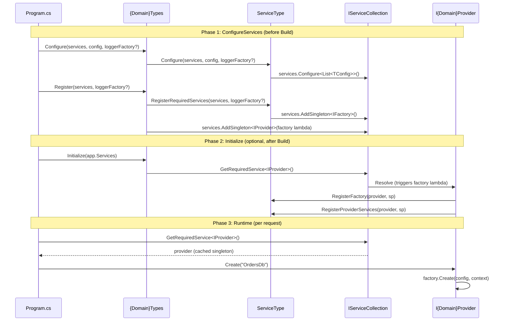

# Service Domains Overview

Service Domains are the plugin architecture for FractalDataWorks services. Each domain (Connections, SecretManagers, Authentication, etc.) follows the same patterns for extensibility, registration, and runtime behavior.

## What is a Service Domain?

A Service Domain is a family of related services that share:
- A common interface (`IGenericConnection`, `ISecretManager`, etc.)
- A factory pattern for creating instances
- Configuration binding from `IConfiguration`
- A provider that acts as a mini-IoC container for the domain
- A `ServiceTypeCollection` for O(1) lookups by name, ID, or other properties

## Core Domains

| Domain | Purpose | Example Implementations |
|--------|---------|------------------------|
| **Connections** | Database and API connections | MsSql, PostgreSql, Rest, GraphQL |
| **SecretManagers** | Credential storage | AzureKeyVault, EnvironmentVariable, UserSecrets |
| **DataStores** | Physical data storage locations | MsSql, Rest, FileSystem |
| **Authentication** | Auth providers | Jwt, OAuth, ApiKey |
| **Notifications** | Alert channels | Email, Slack, Teams |
| **Transformations** | Data transformations | DataCleaning, Mapping |

## Architecture

```mermaid
graph TB
    subgraph "Abstractions Package"
        Interface[I{Domain}]
        Base[{Domain}Base]
        Factory[I{Domain}Factory]
        Config[I{Domain}Configuration]
        ConfigBase[{Domain}ConfigurationBase]
        Collection[{Domain}Types<br/>ServiceTypeCollection]
        Provider[I{Domain}Provider]
    end

    subgraph "Implementation Package"
        DefaultProvider[Default{Domain}Provider]
        Log[{Domain}Log]
    end

    subgraph "Concrete Package (e.g., MsSql)"
        Type[{Name}Type<br/>ServiceTypeOption]
        ConcreteFactory[{Name}Factory]
        ConcreteConfig[{Name}Configuration]
        ConcreteLog[{Name}Log]
    end

    Interface --> Base
    Factory --> Interface
    Config --> ConfigBase
    Collection --> Base
    Provider --> Factory

    DefaultProvider --> Provider

    Type --> Base
    Type --> Collection
    ConcreteFactory --> Factory
    ConcreteConfig --> ConfigBase
```

## Registration Flow



## Consumer Usage

```csharp
var builder = WebApplication.CreateBuilder(args);

// Optional: Logger for startup diagnostics
using var loggerFactory = LoggerFactory.Create(b => b.AddConsole());

// Phase 1: Configure and Register
SecretManagerTypes.Configure(builder.Services, builder.Configuration, loggerFactory);
SecretManagerTypes.Register(builder.Services, loggerFactory);

AuthenticationTypes.Configure(builder.Services, builder.Configuration, loggerFactory);
AuthenticationTypes.Register(builder.Services, loggerFactory);

ConnectionTypes.Configure(builder.Services, builder.Configuration, loggerFactory);
ConnectionTypes.Register(builder.Services, loggerFactory);
ConnectionTypes.RegisterAdditionalInterfaces(builder.Services);  // Registers IDataConnectionProvider

DataStoreServiceTypes.Configure(builder.Services, builder.Configuration, loggerFactory);
DataStoreServiceTypes.Register(builder.Services, loggerFactory);

var app = builder.Build();

// Phase 2: Initialize (optional)
SecretManagerTypes.Initialize(app.Services, loggerFactory);
AuthenticationTypes.Initialize(app.Services, loggerFactory);
ConnectionTypes.Initialize(app.Services, loggerFactory);
DataStoreServiceTypes.Initialize(app.Services, loggerFactory);

app.Run();
```

> **Note:** `Initialize()` is optional. When called, it eagerly resolves all factories at startup, catching configuration errors early. When omitted, factories resolve lazily on first use.

**When to call Initialize():**
- You want startup diagnostics - any factory resolution failures happen immediately
- You want predictable startup timing - no first-request latency
- You're using startup logging and want to see all factory initializations

**When to skip Initialize():**
- You prefer lazy initialization for faster startup
- You have many service types but only use a subset at runtime

## Next Steps

- [Creating a Service Domain](06-02-Creating-Service-Domain.md) - Step-by-step guide
- [TypeCollections Overview](04-01-Overview.md) - Understanding the base pattern
- [MessageLogging](07-01-Overview.md) - Structured logging pattern
